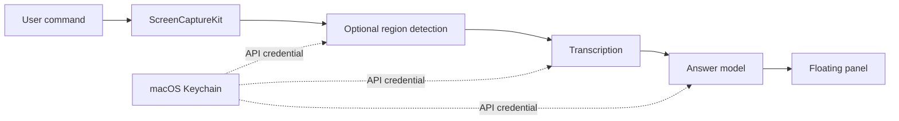

# ScreenCompanion for macOS

A native macOS screen-question assistant built with **Swift, SwiftUI, AppKit, and ScreenCaptureKit**.

Capture a screen on demand, extract the visible question, and display an AI response in a floating panel. Ask a typed question with or without screen context, choose an AI provider, and customize the panel and global keyboard shortcuts.

**Status:** experimental portfolio prototype. Local build, launch, and offline self-tests have been verified on Apple Silicon / macOS 26.1. Live provider calls and the complete screen-permission workflow have not been validated end to end.

[Русская инструкция](docs/usage-ru.txt) · [Architecture](docs/architecture.md) · [Project background](#project-background)

## Why this project

The original ScreenCompanion was a Windows application made by a friend. The starting point was a compiled `.exe`, with no original source project available. This project explores rebuilding its main workflow with native macOS components rather than depending on a Windows runtime.

The engineering work focuses on replacing platform-specific pieces: window management, screenshot capture, keyboard shortcuts, credential storage, and application packaging.

## Features

- Floating answer panel with selectable text, copy controls, resizing, and saved window position.
- On-demand capture of the display under the pointer; the app's own windows are excluded from its captures.
- Optional question-region detection followed by transcription and answering.
- Typed questions, with an option to attach screen context.
- Brief answers, step explanations, English translation, summaries, or a custom instruction.
- Provider adapters for OpenAI, Groq, Google Gemini, Mistral, and OpenRouter.
- Separate vision and answer model selections and per-provider credentials.
- API keys stored in macOS Keychain.
- Configurable global shortcuts, colors, background transparency, and text size.
- Local capture preview and request cancellation.

The app's interface is currently in Russian.

## Build and run

Requirements: macOS 14 or later and Xcode with the macOS SDK.

```sh
git clone https://github.com/whoisaii/screencompanion-macos.git
cd screencompanion-macos
./Source/build.sh
open build/ScreenCompanion.app
```

The build script compiles for the host architecture, creates an app bundle, applies an ad-hoc signature, and runs offline self-tests. The verified build is **arm64**; Intel compatibility is not verified. No third-party runtime or package manager is required to run the built app.

In the app:

1. Open settings, select a provider, and enter an API key.
2. Enter model IDs available to that provider account. Defaults were carried over from the supplied Windows build and are not a guarantee of API availability.
3. Allow screen recording in macOS **System Settings → Privacy & Security**, then restart the app if needed.
4. Show a question and press **Control + Shift + Space**.

Both selected models must support image input. Automatic region detection additionally requires JSON Schema support from the vision model. A chat subscription does not necessarily include API access or credits.

The app is locally signed, not notarized by Apple. Distributed copies may require an explicit Open Anyway action in macOS settings.

## Default shortcuts

| Action | Shortcut |
| --- | --- |
| Capture and answer | Control + Shift + Space |
| Show / hide | Control + / |
| Capture test | Control + Option + T |
| Settings | Control + Option + S |
| Quit | Control + Option + Q |
| Type a question | Control + Backspace |

Shortcuts can be changed in settings and require a modifier key. Menu-bar commands remain available if a shortcut is unavailable.

## Data flow and privacy



Screen content is sent to the selected AI provider only after a user action. With automatic cropping enabled, the **full captured screen is sent to the vision model first**; cropping does not hide unrelated screen content from that initial request.

A screen request normally makes three API calls with cropping enabled, or two without it. A text-only request makes one. Provider pricing, retention, and training settings depend on the account. OpenAI requests use `store: false`; this is not a universal zero-retention guarantee.

The app does not intentionally save screenshots, questions, or answers to disk. Settings and a limited error-code log live under `~/Library/Application Support/ScreenCompanionMac/`. API keys are stored separately in Keychain. Copying an answer places it in the system clipboard.

**External screen recordings:** hiding the panel from Zoom, OBS, browsers, or other recorders is not guaranteed. The app requests window-sharing restrictions, but other capture systems may ignore them. Only exclusion from this app's own captures is implemented explicitly.

## Validation

Run the offline checks after building:

```sh
./build/ScreenCompanion.app/Contents/MacOS/ScreenCompanion --self-test
```

Covered checks include settings serialization, provider request structure, image payloads, response parsing, refusal/incomplete/empty responses, crop validation, JPEG encoding, and duplicate default shortcuts.

Not yet verified: live calls to every provider, capture permission recovery, all global shortcuts across applications, multi-display behavior, external recorder exclusion, and Intel builds. There are no benchmark or production-readiness claims.

## Project background

This is an **unofficial native reimplementation**, based on behavior and metadata examined in a privately supplied ScreenCompanion 0.4.6 Windows executable. It is not the original author's source code or an official macOS release. The original app and idea belong to their respective author; this repository contains the new Swift implementation and documentation. The Windows binary and extracted assemblies are not distributed here.

Development was assisted by OpenAI Codex. This portfolio entry demonstrates a platform adaptation experiment; it does not claim the Windows application was authored here or that every original behavior has been reproduced.

The original's Windows credential format, environment-based QA modes, refusal retries, and exact structured question pipeline are not reproduced. No open-source license has been selected for this repository; public visibility alone does not grant a reuse license.

## Next steps

- Add an integration-test harness with mocked provider responses and capture fixtures.
- Verify live providers and permission recovery on a clean Mac account.
- Split the current app and UI implementation into smaller modules.
- Add English localization and accessibility-focused UI checks.
- Test Intel builds and prepare a notarized distribution if the prototype matures.
